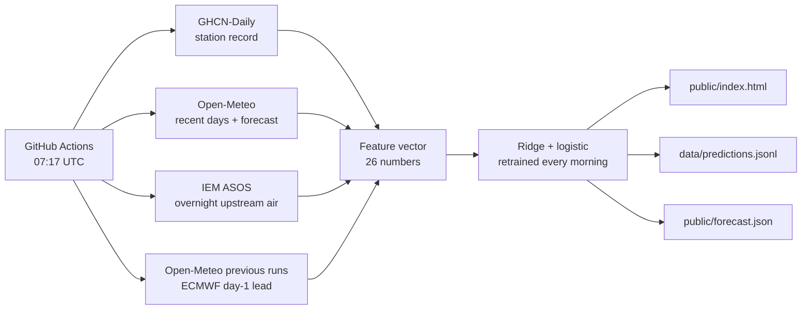
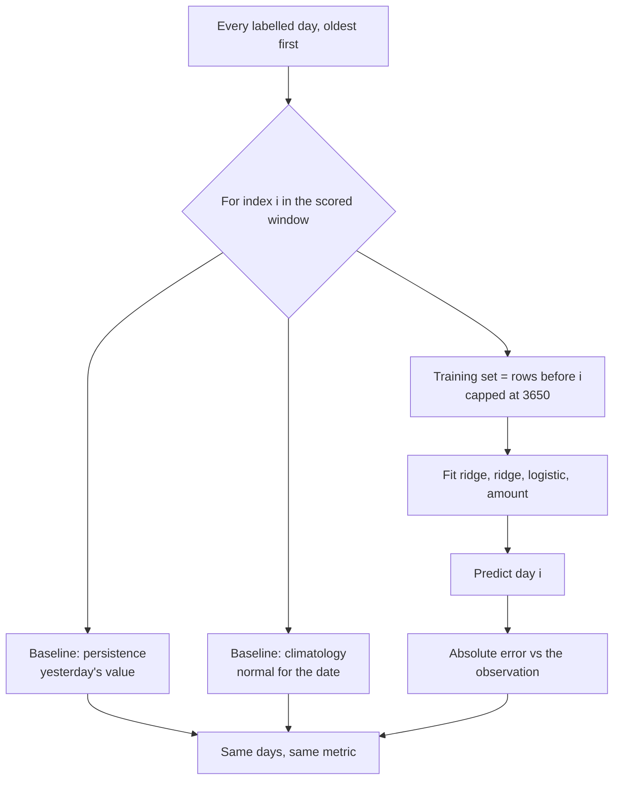
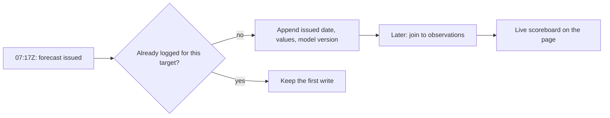

# How the almanac works

A reference for the whole pipeline: what runs each morning, where every number
comes from, how the model is scored, and which rules keep the score honest.

The short version: a GitHub Action wakes at 07:17 UTC, reads four free sources,
builds one 26-number feature vector, retrains two small linear models from
scratch, writes a static page, and appends the forecast to a log before the day
it describes has happened.

## 1. The morning loop



One process, `python -m src.main`, in this order:

1. **Normals** — the 1991–2020 daily high and low for the date, cached in
   `data/normals.json`.
2. **Upstream air** — the regional overnight temperature, extended from
   `data/upstream.json`.
3. **Day-ahead forecast** — ECMWF's day-1 run, extended from `data/nwp.json`.
4. **Observations** — GHCN history merged with Open-Meteo's last two weeks,
   stopping at yesterday.
5. **Dataset** — one row per labelled day, built by the same function that will
   build the live row.
6. **Score** — retrain and predict for each of the last 365 days, in order.
7. **Predict** — retrain on everything and predict tomorrow's target day.
8. **Narrate** — z.ai writes the note from the finished numbers.
9. **Publish** — HTML, JSON, and one line in the prediction log.

## 2. Inputs, and when they exist

| source | what it supplies | latency at press time |
|---|---|---|
| [GHCN-Daily](https://www.ncei.noaa.gov/products/land-based-station/global-historical-climatology-network-daily), station `USW00013881` | daily high, low, precipitation for the airport, 1939 onward | 2–4 days behind |
| [Open-Meteo](https://open-meteo.com/) forecast API | the last 14 days of analysis, plus a 3-day forward forecast | minutes |
| [IEM ASOS](https://mesonet.agron.iastate.edu/) `KATL KGSP KCAE KAVL` | mean temperature 00Z–05Z, i.e. the air heading toward Charlotte | about an hour |
| [Open-Meteo previous runs](https://open-meteo.com/en/docs/previous-runs-api), `ecmwf_ifs025` | the day-1 and day-2 lead forecasts, from 2024-06-01 | 24 hours of lead, by construction |

```mermaid
timeline
    title What the 07:17Z run can see about target day D
    D-2 : GHCN station row usually arrives
    D-1 00Z to 05Z : Upstream airport reports on the wire
    D-1 07:17Z : The day-1 forecast is issued
    D 07:17Z : This run reads it, builds features, publishes
```

Every input is free and keyless. The only secret in the system is the z.ai key
for the prose, and the page still publishes without it.

## 3. The features

Built by `src/features.py`. Every value for a target day uses only data from
strictly before that day, and the live path calls the exact same function as the
backtest.

| group | features | what they encode |
|---|---|---|
| recent state | `tmax_lag1`, `tmin_lag1`, `precip_lag1`, `tmax_lag2`, `tmax_lag3` | where the last three days landed |
| means | `tmax_mean7`, `tmax_mean14`, `tmin_mean3` | the spell, not the day |
| anomalies | `tmax_anomaly_lag1`, `tmax_anomaly_mean3`, `tmax_anomaly_mean7` | departure from the normal for those dates |
| shape | `tmax_trend3`, `diurnal_range_lag1`, `precip_sum7` | warming/cooling trend, clear-sky range, wet ground |
| calendar | `normal_tmax_target`, `season_sin`, `season_cos`, `season_sin2`, `season_cos2` | the time of year, smoothly |
| upstream air | `upstream_overnight`, `upstream_vs_charlotte`, `upstream_change` | the air mass upwind, and whether it is moving |
| day-ahead | `nwp_tmax`, `nwp_tmin`, `nwp_vs_lag1`, `nwp_trend` | what ECMWF said 24 hours ago, and how it differs from persistence |

The first 22 are the original model. The last four appear only when a forecast
series is supplied, so the same code can build either version.

## 4. The models

`src/models.py`, plain numpy, no dependencies beyond it.

**Temperatures — ridge regression.** Features are standardised on the training
window, the intercept is the training mean, and

```
β = (XᵀX + αI)⁻¹ Xᵀ (y − ȳ)
```

with `α = 1.0`. Fitted separately for the high and the low.

**Rain — two models.** An L2-penalised logistic regression (Newton steps on the
penalised log-likelihood, intercept unpenalised) gives the chance of ≥ 0.01 in.
A second ridge, fitted only on wet days, predicts `log1p(amount)`. The expected
rainfall on the page is `P(wet) × expm1(amount)`, clipped.

Everything is deliberately small: fitting all four models takes milliseconds,
which is what makes it practical to retrain for every single backtest day.

## 5. Scoring



`learn.backtest` walks forward: for each day in the window it trains on prior
rows only, predicts, and scores. Because `build_dataset` and `vector` are shared
with the live path, the backtest is not a reimplementation that could quietly
see the answer.

Reported on the page: model MAE, persistence MAE, climatology MAE, and rain
Brier against the climatological base rate.

Separately, `data/predictions.jsonl` is a real-time ledger:



## 6. Where the numbers stand

365-day window ending 2026-11-01, 884 labelled rows, identical folds for every
arm.

| | high MAE | low MAE | rain Brier |
|---|---|---|---|
| **Shipped model (v4)** | **2.17** | **1.98** | **0.158** |
| Same features, day-ahead series shuffled | 4.92 | 3.32 | 0.173 |
| Lagged features only, same era | 4.95 | 3.31 | 0.171 |
| Persistence | 5.57 | 4.65 | — |
| Climatology | 7.40 | 6.67 | 0.184 |

Raw ECMWF day-1 error is 3.00 on the high with a −1.84°F cold bias, so the ridge
is correcting a systematic offset rather than copying the forecast. The shuffled
row is the integrity check: destroy the ordering of the forecast series and the
entire gain disappears.

The 2.17 is the number the model was selected on, not a held-out year. Split in
half, it runs 2.40 in the cool half and 1.94 in the warm half — read it as "low
2s", with the usual caveat that a single 365-day window is a small sample.

## 7. Rules that keep it honest

- **No look-ahead in the feature builder.** Every lag is ≥ 1 day; the gap filler
  reads the previous day only. Averaging two neighbours used to put tomorrow's
  value inside today's features.
- **One feature builder.** `vector()` serves the backtest and the live forecast.
- **No imputed forecasts in training.** A row without a real day-ahead value is
  dropped, so the model never learns an "empty" forecast.
- **The log is append-once.** First write wins; a rerun cannot improve a call,
  and a target the record has already reached is never logged.
- **Explicit NWP model.** `ecmwf_ifs025`, never `best_match`, which recombines
  models hour by hour into a series no single model issued.
- **Observations stop at yesterday.** Today's daily value is still an estimate.
- **Failed sources degrade, they do not guess.** See the table below.

## 8. Caches and failure modes

| cache | holds | if it is missing |
|---|---|---|
| `data/normals.json` | 1991–2020 daily normals | refetched |
| `data/upstream.json` | daily 00Z–05Z regional mean, 2005→ | backfilled from IEM |
| `data/nwp.json` | day-1/day-2 forecasts, 2024-06-01→ | refetched in 180-day chunks |
| `data/predictions.jsonl` | issued forecasts, last 730 | starts empty |

Both caches derive their coverage from the days that actually arrived, so a span
the service had no data for is asked for again rather than written off.

If the day-ahead cache cannot be fetched, the run falls back to the 22-feature
lagged model on the full station history — the pre-v4 behaviour — and labels
itself `ridge-logistic-v3` on the page and in the log. If GHCN is unreachable,
Open-Meteo's archive takes over as history. If z.ai fails, a template writes the
note and the page says so.

## 9. Files

| file | role |
|---|---|
| `src/main.py` | orchestration, prediction log, page state |
| `src/weather.py` | GHCN + Open-Meteo merge, normals |
| `src/upstream.py` | IEM ASOS cache |
| `src/nwp.py` | previous-runs cache and hourly→daily aggregation |
| `src/features.py` | the 26-number vector |
| `src/learn.py` | dataset, walk-forward backtest, live prediction |
| `src/models.py` | ridge and logistic, in numpy |
| `src/narrative.py` | z.ai call, parsing, template fallback |
| `src/site.py` | static HTML, inline CSS, hand-drawn SVG |
| `scripts/experiment_nwp.py` | A/B/shuffled comparison for the forecast block |
| `tests/test_pipeline.py` | 12 regression tests, stdlib only, no network |

## 10. Known limits

- Linear on 26 features: no front detection, no tropical systems, no cold-air
  damming beyond what the upstream air implies.
- The day-ahead archive starts June 2024, so training is ~2.5 years, not twenty.
- ECMWF's cold bias is learned, not corrected; a model change would need a
  relearn.
- One grid cell near uptown. The airport, Matthews and Lake Norman will differ.
- This is a notebook, not an official forecast.
